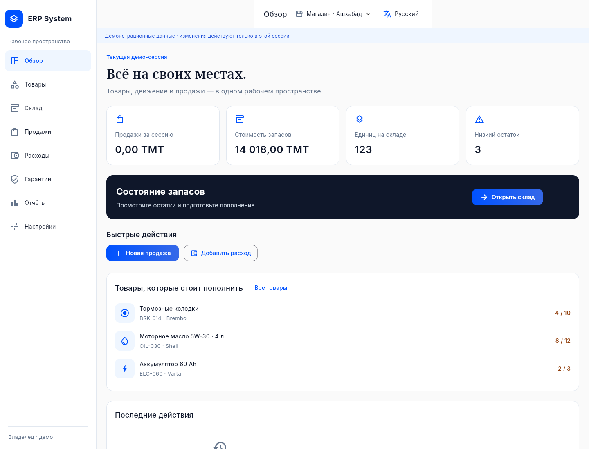
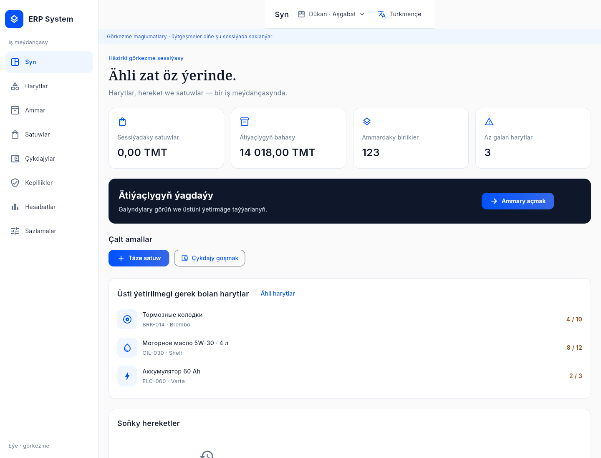
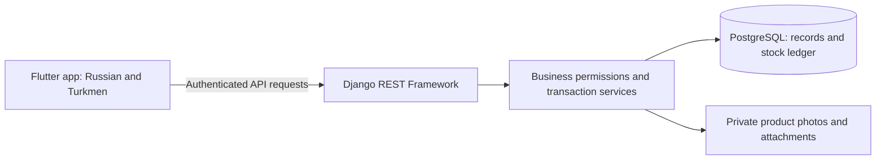

# ERP System

A bilingual, tablet-first inventory ERP for shops and wholesalers in Turkmenistan. Manage products, receive goods by scanning, track stock across locations, record sales and returns, and review business activity in **Russian** or **Turkmen**.

Built with **Flutter · Django REST Framework · PostgreSQL**. Android tablets are the first target; the browser build supports development and testing. iPad and iPhone are a later stage.

[Try it locally](#try-it-locally) · [Developer setup](docs/DEVELOPMENT.md) · [Russian guide](docs/USER_GUIDE_ru.md) · [Turkmen guide — draft](docs/USER_GUIDE_tk.md)

## Interface preview



<details>
<summary>View the Turkmen dashboard</summary>



</details>

The previews use the explicit demonstration build with sample records and a visible demo banner. Changes in this mode reset when the app restarts; they do not represent a connected shop. See [preview notes](docs/images/README.md).

## What the app does

| Workflow | Included |
| --- | --- |
| Catalog | Products, barcodes and article numbers, categories, units, pictures, list/gallery views, CSV import and export |
| Receiving | Scan or type a code, enter a quantity, add an unknown product, and post a restart-safe receipt |
| Missing information | Receive without a cost; complete missing prices and costs later. Profit excludes sales with unknown costs and identifies the omitted amounts |
| Inventory | Per-location stock, FIFO costs, opening stock, adjustments, history, transfers in transit, and approved stock counts |
| Sales | Search or scan, set each line's selling price, record cash/card, and generate a Russian or Turkmen receipt PDF |
| After-sales | Customer returns linked to the sale, condition tracking, return periods, and warranty claims |
| Business review | Expenses with private receipt attachments, role-aware dashboard, reports, CSV exports, and activity history |
| Administration | Business profile, locations, staff access, language settings, and USD-to-TMT exchange rate |

The server enforces business isolation, role permissions, stock availability, and duplicate-request protection. Stock-changing actions require internet access. TMT is the business currency; product selling prices may be stated in USD and converted using the configured rate.

**Current scope:** purchasing, suppliers, purchase orders, supplier returns, and the reorder workflow have been removed from the app. Minimum-stock alerts remain. Legacy purchasing backend code still exists and is tracked for removal in [PLAN.md, step 9.10](PLAN.md). The current roles are owner, manager, sales and warehouse; a proposed three-role replacement is still pending a decision.

This is an inventory ERP, with cash/card recorded as payment labels. It does not process payments, calculate tax or change, issue invoices, or provide full accounting. The report's operating result is not accounting profit.

## Try it locally

### Full system with sample business records

Follow [the local test guide](docs/LOCAL_TEST.md) for the one-download test package or the source-based launcher. It starts a local PostgreSQL database, Django server, web app and install page without Docker, and prints test accounts and a generated password.

The [Latest test build](https://github.com/AzatKabulov/ERP-System/releases/tag/test-build) is a mutable testing release. Check its commit against the source you are using; it can lag behind `main`. Use only disposable sample data for this setup.

### Interface-only demo for developers

Install the pinned **Flutter 3.47.6** SDK, then from a clone of this repository:

```sh
cd mobile
flutter pub get --enforce-lockfile
flutter gen-l10n
flutter run -d chrome --dart-define=DEMO_MODE=true
```

No backend or sign-in is needed for this demo. To run on an Android device instead, find its identifier with `flutter devices` and replace `chrome` with that identifier. Scanning and printing need separate checks on real hardware.

### Connected app development

Normal builds start at sign-in and need the API. See [developer setup](docs/DEVELOPMENT.md) for PostgreSQL, backend settings, test commands, and the cloud helpers. The browser build normally uses the origin it was served from; local development can set `API_BASE_URL`. Android users select their server on the sign-in screen.

For a test server and signed direct-install Android build, use [test deployment](docs/DEPLOY_TESTING.md) and [Android release instructions](docs/ANDROID_RELEASE.md).

## How it fits together



Pending operations retain their identities across retries and restarts. The API owns stock and money calculations; finalized movements retain their history. Private files are served through permission checks and must be backed up with the database.

## Repository map

| Path | Purpose |
| --- | --- |
| [`mobile/`](mobile/) | Shared Flutter app, Russian/Turkmen localizations, unit and widget tests, Android/web hosts |
| [`backend/`](backend/) | Django API, migrations, transaction services, PostgreSQL tests, and locked Python dependencies |
| [`infra/`](infra/) | Container stack, HTTPS proxy, installation page, and deployment runbook |
| [`scripts/`](scripts/) | Environment setup, local test launcher, packaging, deployment, and browser checks |
| [`docs/`](docs/) | Requirements, architecture, design system, setup, and user guides |

## Validation and remaining work

[HANDOFF.md, section 4](HANDOFF.md#4-checks-actually-run) records prior validation with its environment and limitations. [GitHub Actions](https://github.com/AzatKabulov/ERP-System/actions/workflows/ci.yml) runs Flutter checks, web/Android builds, backend checks on PostgreSQL, and a container build. Check the run for the commit you use; historical results do not establish that every later commit passes.

Real-tablet camera scanning, receipt printing/sharing, TalkBack, a deployed staging server, real recovery-email delivery, and iOS still need validation. Turkmen terminology needs fluent-speaker review. Tooling for backups and deployment is present; production readiness requires the pilot and recovery checks in the plan.

## Project documents

- [Product requirements](docs/PRD.md) — scope and business decisions
- [Delivery plan](PLAN.md) — remaining steps and open decisions
- [Current state and validation](HANDOFF.md) — implementation notes and evidence
- [Architecture](docs/ARCHITECTURE.md) — application boundaries and data rules
- [Design system](docs/DESIGN_SYSTEM.md) — shared visual and accessibility rules
- [Developer setup](docs/DEVELOPMENT.md) — toolchains, commands, and cloud environments
- [Agent instructions](AGENTS.md) — repository contribution rules

For a bug report, include the app/server commit, device, interface language, steps, expected result, and actual result. Use sample records and remove credentials or customer details from screenshots.
